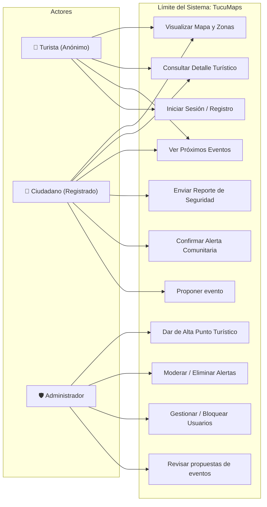

---
tags:
  - facultad
  - tfi
  - tucumaps
  - uml
  - casos-de-uso
fecha: 2026-09-28
materia: Trabajo Final Integrador
tipo: diseno-uml
---

# 📐 Diagrama de Casos de Uso — TucuMaps

> [!info] Documentación Relacionada
> - **Proyecto Central:** [[TucuMaps|TucuMaps - Hub Principal]]
> - **Teoría de Modelado UML:** [[11-09 Metodología II|Metodología II — Casos de Uso (Include/Extend)]]
> - **Especificación de Requerimientos:** [[SRS preliminar|SRS Preliminar]]

---

## 👥 1. Definición de Actores del Sistema

1. **Usuario Anónimo (Turista):**
   * Perfil sin credenciales. Su interacción es puramente de consulta e informativa.
2. **Usuario Registrado (Ciudadano):**
   * Cuenta activa. Puede consultar información, enviar reportes de seguridad, proponer eventos y confirmar alertas publicadas como aporte comunitario.
3. **Administrador del Sistema:**
   * Rol privilegiado responsable de la gobernanza, moderación del contenido y mantenimiento de datos maestros.

---

## 📊 2. Diagrama de Casos de Uso (UML)

Los reportes de seguridad y las propuestas de eventos enviados por usuarios quedan pendientes de revisión. Solo el administrador puede aprobarlos para su publicación; las confirmaciones comunitarias no reemplazan esta aprobación.

---

## 📋 3. Matriz de Permisos y Casos de Uso

| Caso de Uso | Turista (Anónimo) | Ciudadano (Registrado) | Administrador |
| :--- | :---: | :---: | :---: |
| **Visualizar Mapa Interactivo** | ✅ | ✅ | ✅ |
| **Consultar Puntos Turísticos y Eventos** | ✅ | ✅ | ✅ |
| **Registrarse e Iniciar Sesión** | ✅ | — | — |
| **Enviar Reportes de Seguridad** | ❌ | ✅ | ❌ |
| **Confirmar Alertas Comunitarias Publicadas** | ❌ | ✅ | — |
| **Proponer Eventos** | ❌ | ✅ | — |
| **Revisar y aprobar propuestas de eventos** | ❌ | ❌ | ✅ |
| **Alta y Edición de Sitios Turísticos** | ❌ | ❌ | ✅ |
| **Moderar y Descartar Reportes Falsos** | ❌ | ❌ | ✅ |
| **Bloquear Usuarios Reincidentes** | ❌ | ❌ | ✅ |
