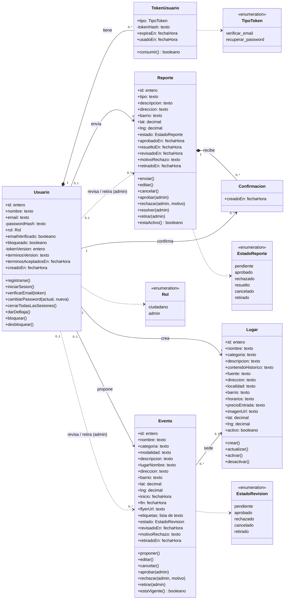
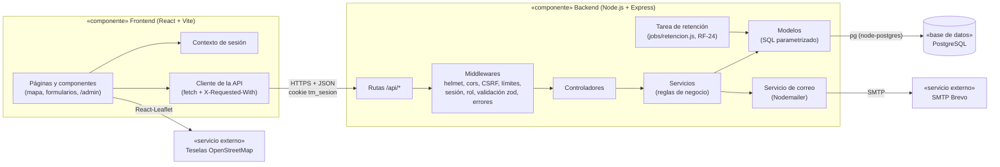
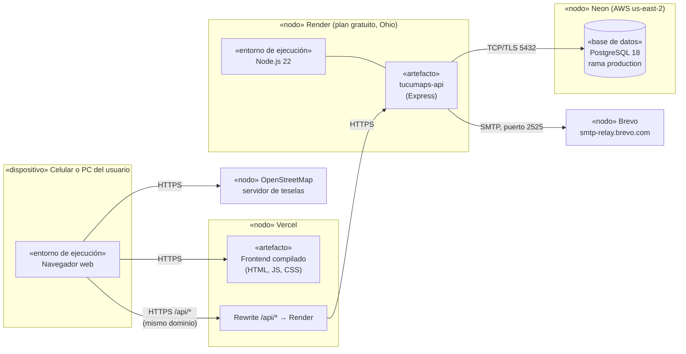

---
tags:
  - facultad
  - tfi
  - tucumaps
  - uml
  - arquitectura
fecha: 2026-10-16
materia: Trabajo Final Integrador
tipo: diseno-uml
---

# 🧩 Diagramas de Clases, Componentes y Despliegue — TucuMaps

> [!info] Documentación Relacionada
> - **Proyecto Central:** [[TucuMaps|TucuMaps - Hub Principal]]
> - **Casos de uso:** [[Diagrama de casos de uso TucuMaps|Diagrama de Casos de Uso]]
> - **Modelo de datos y estados:** [[Modelo de datos TucuMaps|Modelo de Datos y Diagramas de Estado]]
> - **Arquitectura y stack:** [[Tecnologias TucuMaps|Stack Tecnológico]]
> - **Contrato de la API:** [[API TucuMaps|Especificación de la API REST]]

Los tres diagramas siguen la notación UML y se dibujan con Mermaid, que Obsidian y GitHub muestran sin complementos.

---

## 1. Diagrama de clases del dominio

Es un modelo **conceptual**: muestra las entidades del sistema, sus atributos, las operaciones de negocio y cómo se relacionan. En el código, el backend no usa clases de JavaScript: cada entidad se reparte entre un **modelo** (SQL) y un **servicio** (reglas de negocio), según las capas de la sección 2. Los atributos coinciden con `schema.sql`; los de la pre-validación con IA (`ia_*`, evolutivo, RF-20) se omiten para no recargar el diagrama.

**Cómo leerlo:**

- **Multiplicidad `0..1` del lado de `Usuario`:** el autor de un reporte o evento puede quedar vacío si borra su cuenta o pasa el plazo de retención de 1 año (RF-24). Por eso los reportes y eventos no dependen de la vida del usuario.
- **Composición (rombo lleno):** los tokens no existen sin su usuario, y las confirmaciones no existen sin su reporte. Si se borra el todo, se borran las partes (`ON DELETE CASCADE`).
- **Dependencias punteadas "revisa / retira":** las operaciones `aprobar`, `rechazar`, `resolver` y `retirar` solo las hace un `Usuario` con `rol = admin`, y quedan registradas en `revisado_por` y `retirado_por` (RF-13, RF-15).
- **Restricciones que no se ven en el diagrama:**
  - Una sola `Confirmacion` por usuario y reporte, y nunca sobre un reporte propio (RF-14).
  - `lat` y `lng` dentro de la caja de Tucumán (RF-10).
  - `fin` posterior a `inicio`.
  - Las transiciones válidas de `estado` están en los diagramas de estado de [[Modelo de datos TucuMaps]].
- **Operaciones de consulta:** `estaActivo()` (aprobado hace menos de 24 hs, RF-11) y `estaVigente()` (hasta 24 hs después del evento, RF-12) corresponden a las vistas `reportes_activos` y `eventos_vigentes`.

---

## 2. Diagrama de componentes

Muestra cómo se organiza el software por dentro: el frontend en React y el backend en capas (**rutas → controladores → servicios → modelos**). Las reglas de negocio viven en los servicios y el SQL solo en los modelos.

| Capa | Carpeta | Responsabilidad |
| :--- | :--- | :--- |
| Rutas | `backend/src/routes/` | Declaran cada endpoint y qué middlewares lleva (sesión, rol, validación). |
| Middlewares | `backend/src/middlewares/` | Seguridad y validación comunes: sesión JWT, rol, encabezado anti-CSRF, límites de solicitudes, esquemas `zod`, formato de error. |
| Controladores | `backend/src/controllers/` | Traducen la solicitud HTTP a una llamada al servicio y arman la respuesta. |
| Servicios | `backend/src/services/` | Reglas de negocio: estados, límites diarios, permisos, envío de correos. |
| Modelos | `backend/src/models/` | Consultas SQL parametrizadas a PostgreSQL. |

---

## 3. Diagrama de despliegue

Muestra dónde corre cada parte en producción. Todos los servicios usan planes gratuitos.

**Decisiones que explica el diagrama:**

- **Rewrite de Vercel:** el navegador solo habla con el dominio de Vercel. Vercel reenvía `/api/*` a Render, así la cookie de sesión `tm_sesion` es del mismo sitio y Safari no la bloquea.
- **Render en reposo:** el plan gratuito duerme el backend tras un rato sin uso, y la primera consulta tarda más (por eso el frontend muestra estados de carga, RF-06). La tarea de retención corre al arrancar el servidor y cada 24 horas.
- **Versión de Node:** el backend pide Node 20 o superior (`engines` en `package.json`, y el CI usa 20); Render lo corre con Node 22 (`NODE_VERSION` en `render.yaml`).
- **Puerto 2525 para correo:** Render gratuito bloquea los puertos SMTP habituales (25, 465 y 587); Brevo acepta el 2525.
- **Ramas de Neon:** producción usa la rama `production`. Las ramas `desarrollo`, `tests` y `frontend` son para trabajar en local y no forman parte del despliegue.
- **Fuera del diagrama (planificado o evolutivo):**
  - Copias de seguridad con `pg_dump` desde la compu de Nacho (Fase 5).
  - n8n para la pre-validación con IA (RF-20, evolutivo).

---

## Historial

| Fecha | Cambio |
| :--- | :--- |
| 2026-10-16 | Primera versión: clases del dominio, componentes y despliegue. |
| 2026-10-19 | Despliegue: Render corre Node.js 22 (`NODE_VERSION` en `render.yaml`); el backend pide Node 20 o superior. |
