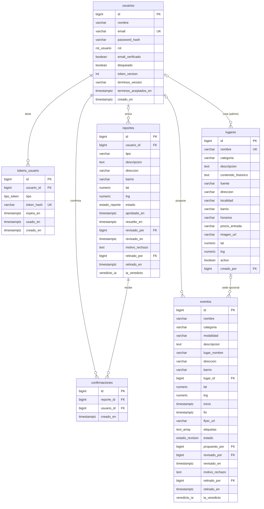
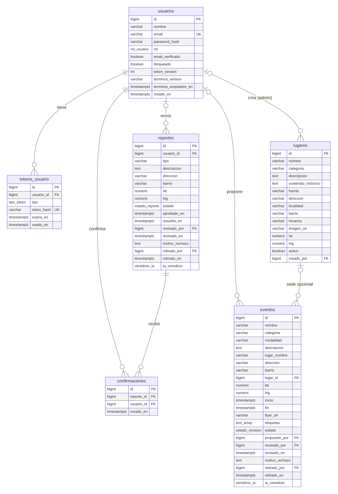
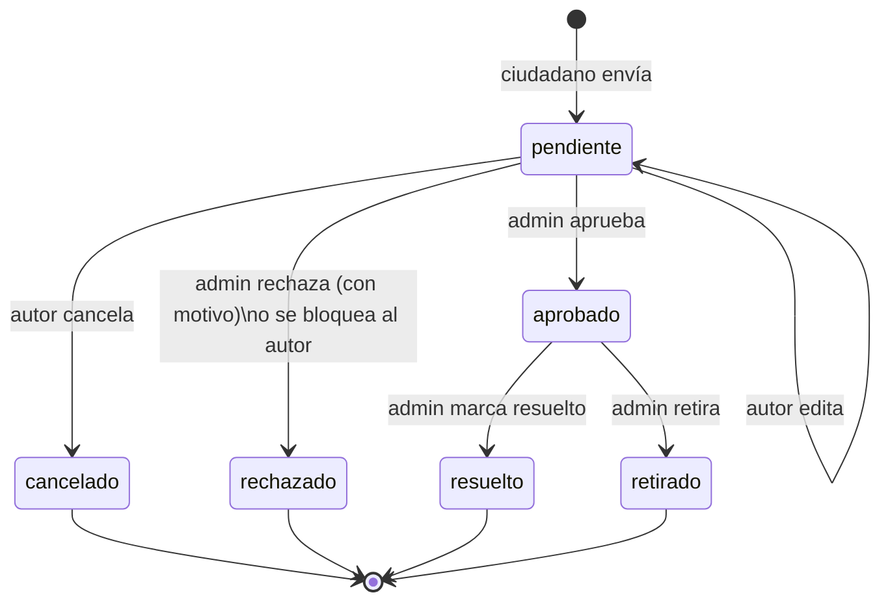
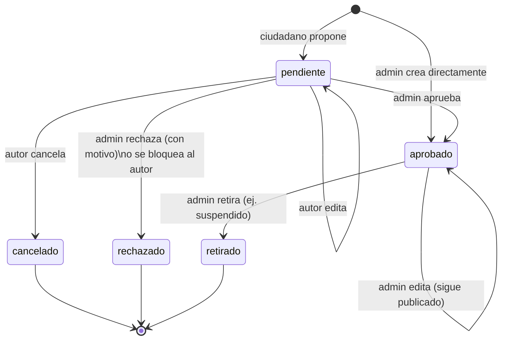
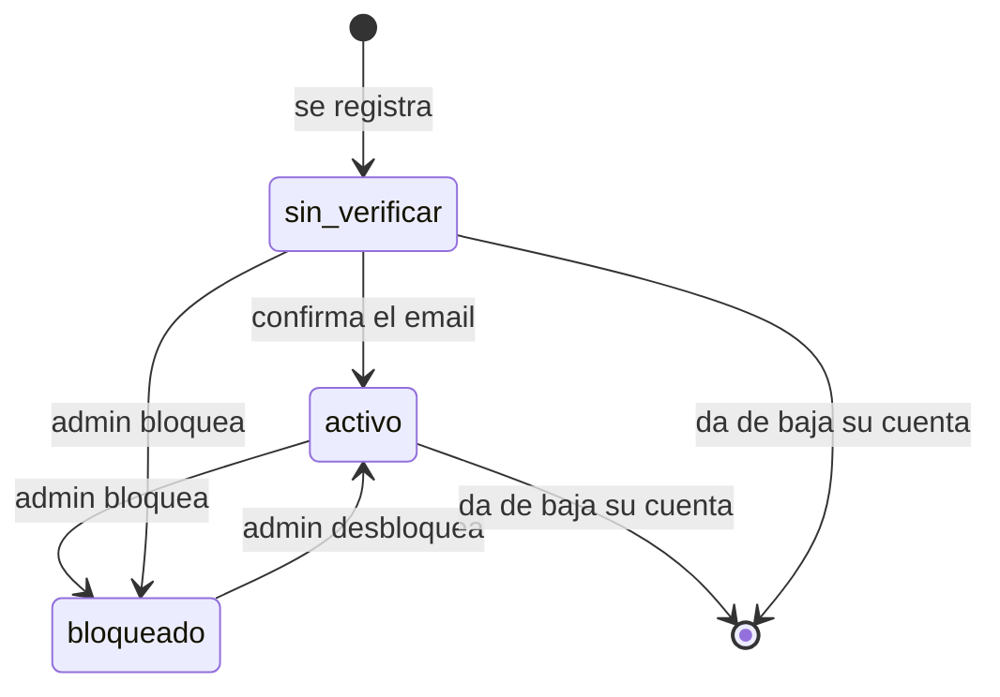
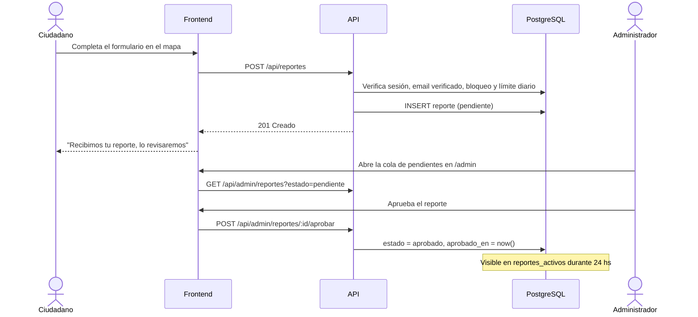

---
tags:
  - facultad
  - tfi
  - tucumaps
  - base-de-datos
  - uml
fecha: 2026-10-12
materia: Trabajo Final Integrador
tipo: diseno-datos
---

# 🗄️ Modelo de Datos y Diagramas de Estado — TucuMaps

> [!info] Documentación Relacionada
> - **Proyecto Central:** [[TucuMaps|TucuMaps - Hub Principal]]
> - **Requerimientos:** [[SRS preliminar|SRS Preliminar]]
> - **Script SQL:** `schema.sql` (fuente de verdad del modelo)
> - **API:** [[API TucuMaps|Especificación de la API REST]]

---

## 1. Diagrama Entidad-Relación

> [!note] Imagen
> `img/ERD_TucuMaps.png` se generó a partir de este diagrama (v1.7). Las columnas `ia_confianza`, `ia_motivo`, `ia_analizado_en`, `creado_en` y `actualizado_en` se omiten en el gráfico por espacio; el detalle completo está en `schema.sql`.

**Decisiones de diseño**
- `reportes.usuario_id` y `eventos.propuesto_por` admiten `NULL` para poder borrar cuentas y aplicar la retención de 1 año sin perder el historial (RF-24).
- Los catálogos (tipo de reporte, categorías, modalidad) son `CHECK` sobre texto: simples de validar y de mostrar; agregar un valor requiere una migración.
- Las vistas `reportes_activos` y `eventos_vigentes` concentran las reglas de vigencia (RF-11, RF-12) y nunca exponen al autor.
- Las columnas `ia_*` existen desde el inicio aunque la IA sea evolutiva, para no migrar después.

---

## 2. Estados de un reporte de seguridad

| Transición | Quién | Registra |
| :--- | :--- | :--- |
| → `pendiente` | Ciudadano con email verificado y no bloqueado, dentro del límite diario | `creado_en` |
| `pendiente` → `pendiente` (edición) | Autor | `actualizado_en` |
| `pendiente` → `cancelado` | Autor | `actualizado_en` |
| `pendiente` → `aprobado` | Admin | `revisado_por`, `revisado_en`, `aprobado_en` |
| `pendiente` → `rechazado` | Admin (motivo obligatorio) o el sistema al bloquear al autor ("Usuario bloqueado") | `revisado_por`, `revisado_en`, `motivo_rechazo` |
| `aprobado` → `resuelto` | Admin | `resuelto_en` |
| `aprobado` → `retirado` | Admin (sin motivo) | `retirado_por`, `retirado_en` |

- Un reporte `aprobado` se ve en el mapa solo durante 24 hs desde `aprobado_en` (RF-11); después sigue `aprobado` pero ya no está activo.
- Los estados `cancelado`, `rechazado`, `resuelto` y `retirado` son finales: no se reabren.
- Las confirmaciones comunitarias (RF-14) solo se aceptan sobre reportes activos y no cambian el estado.

---

## 3. Estados de un evento

- Un evento `aprobado` se archiva solo, sin cambiar de estado, 24 hs después de `fin` (o de `inicio` si no tiene fin) (RF-12). Retirarlo es para casos excepcionales, como un evento suspendido o con datos incorrectos.
- Los estados `cancelado`, `rechazado` y `retirado` son finales.

---

## 4. Estados de un usuario

- `sin_verificar` puede iniciar sesión y consultar, pero no enviar reportes, proponer eventos ni confirmar alertas (RF-03).
- Al bloquear: la sesión se corta en la siguiente solicitud y los envíos `pendiente` pasan a `rechazado` (RF-16).
- Un administrador no puede bloquearse ni darse de baja a sí mismo si es el único administrador.

---

## 5. Secuencia: envío y moderación de un reporte

