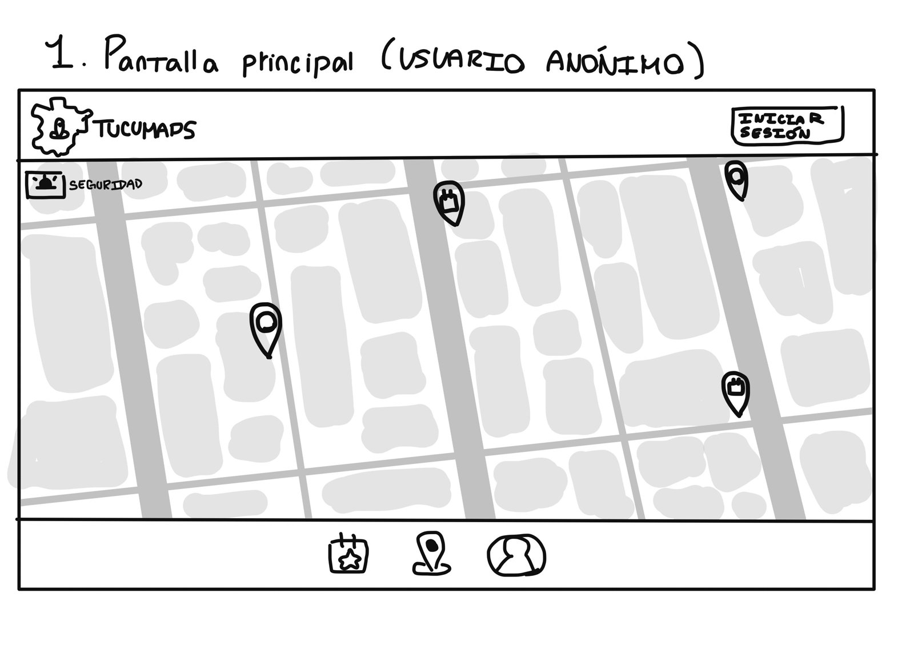
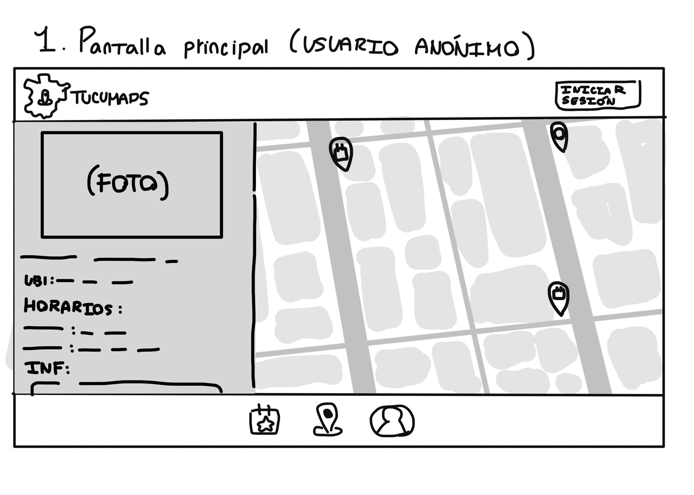
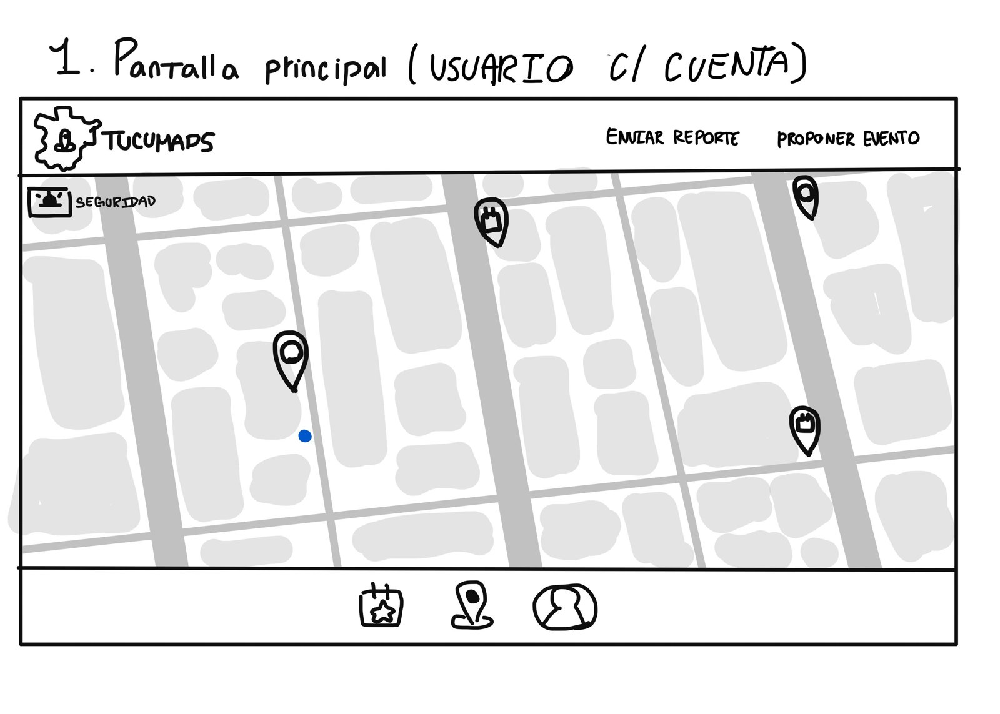
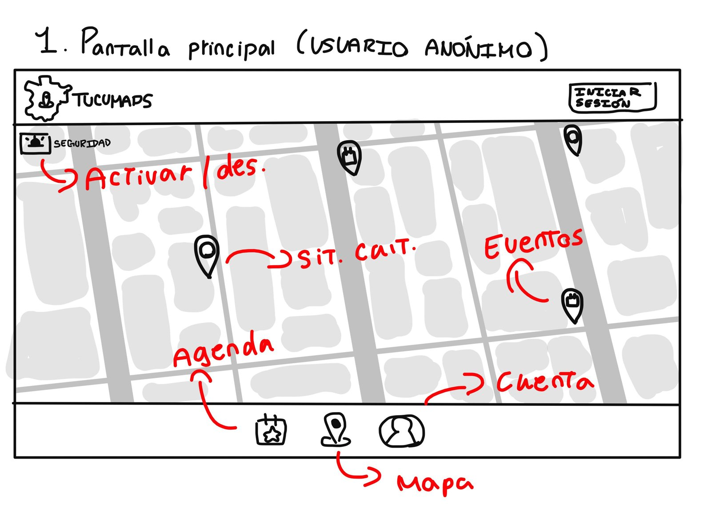
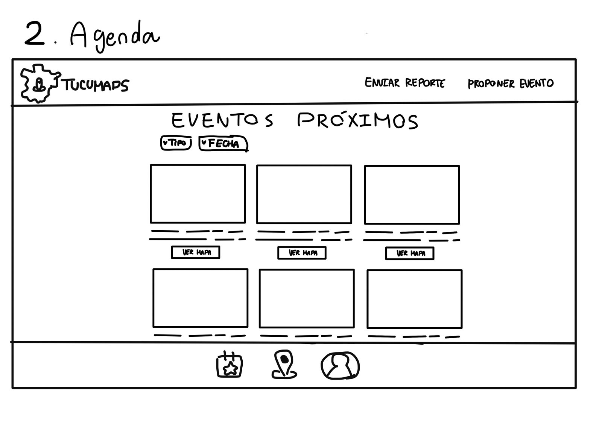
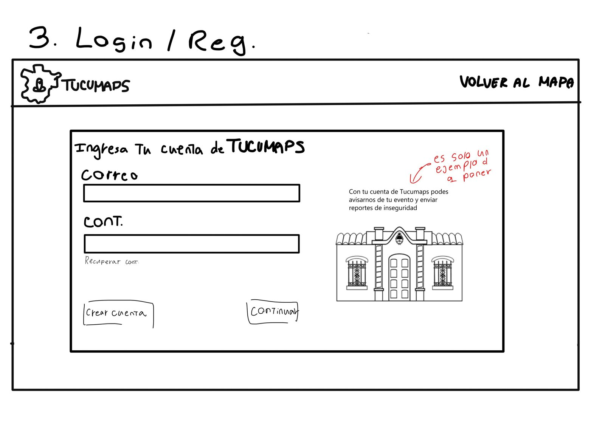
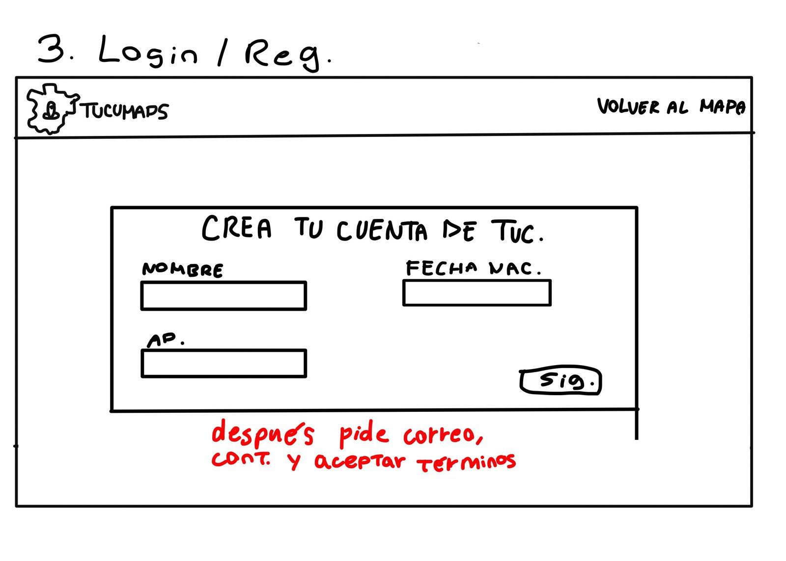
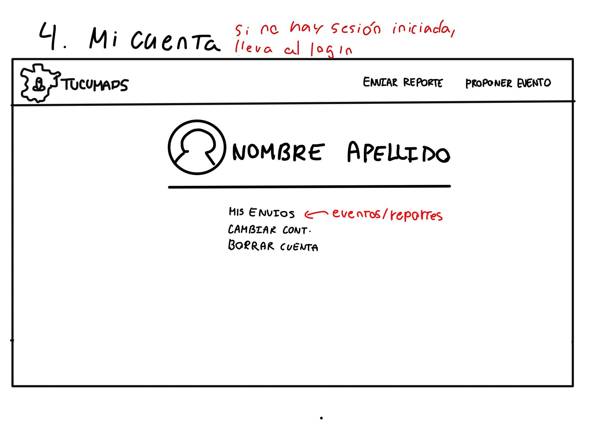

# Pantallas TucuMaps

Bocetos a mano de las pantallas principales de la app.

> Son bocetos (wireframes). Muestran qué va en cada pantalla y dónde, no el diseño final. Los colores y las fuentes están en **Diseño TucuMaps.md**.

---

## 1. Pantalla principal

### Usuario anónimo (sin sesión)

- **Navbar:** logo de TucuMaps a la izquierda y botón **"Iniciar sesión"** a la derecha.
- **Botón "Seguridad"** arriba a la izquierda del mapa.
- **Mapa** con marcadores de sitios culturales y eventos.
- **Barra inferior:** Agenda, Mapa y Cuenta.

### Usuario anónimo, con un sitio seleccionado

Al tocar un marcador se abre un **panel a la izquierda** con:

- Foto del lugar
- Nombre
- Ubicación
- Horarios
- Información

### Usuario con cuenta (sesión iniciada)

- En la navbar, "Iniciar sesión" se reemplaza por **"Enviar reporte"** y **"Proponer evento"**.
- El punto azul en el mapa es la **ubicación del usuario**.

### Referencias de la pantalla principal

| Elemento | Qué hace |
|---|---|
| Botón Seguridad | Activa o desactiva la capa de seguridad en el mapa |
| Marcador celeste | Sitio cultural |
| Marcador amarillo | Evento |
| Ícono de calendario (abajo) | Abre la **Agenda** |
| Ícono de pin (abajo) | Vuelve al **Mapa** |
| Ícono de persona (abajo) | Abre **Mi cuenta** |

---

## 2. Agenda

- Título **"Eventos próximos"**.
- Filtros por **tipo** y por **fecha**.
- Grilla de tarjetas de eventos (imagen y texto), cada una con un botón **"Ver mapa"**.
- Misma navbar y barra inferior que la pantalla principal.

---

## 3. Login y registro

### Iniciar sesión

- Navbar con el botón **"Volver al mapa"**.
- Formulario "Ingresá tu cuenta de TucuMaps":
  - Correo
  - Contraseña
  - Enlace **"Recuperar contraseña"**
  - Botones **"Crear cuenta"** y **"Continuar"**
- A la derecha, una imagen (la Casa Histórica) y un texto corto, por ejemplo: *"Con tu cuenta de TucuMaps podés avisarnos de tu evento y enviar reportes de inseguridad"*. Ese texto es solo un ejemplo.

### Crear cuenta

Formulario "Creá tu cuenta de TucuMaps", en dos pasos:

1. **Primer paso:** nombre, apellido y fecha de nacimiento, y el botón **"Siguiente"**.
2. **Segundo paso:** correo, contraseña y aceptar los términos.

---

## 4. Mi cuenta

> Si no hay sesión iniciada, esta pantalla lleva al login.

- Foto de perfil, con **nombre y apellido**.
- Opciones:
  - **Mis envíos** (los eventos y reportes que mandó el usuario)
  - **Cambiar contraseña**
  - **Borrar cuenta**
